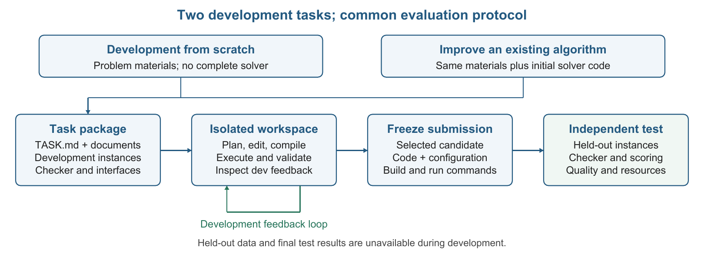

<div align="center">

# How Good Are Coding Agents at Automatic Algorithm Design?

**Haoze Lv<sup>1,2</sup>, Shaofeng Zhang<sup>1,2</sup>, Shengcai Liu<sup>1,2\*</sup>, Ke Tang<sup>1,2\*</sup>**

<sup>1</sup>Guangdong Provincial Key Laboratory of Brain-Inspired Intelligent Computation, Department of Computer Science and Engineering, Southern University of Science and Technology<br>
<sup>2</sup>Zhongguancun Academy<br>
<sup>\*</sup>Corresponding authors: `liusc3@sustech.edu.cn`, `tangk3@sustech.edu.cn`

[](#citation)
[](https://huggingface.co/datasets/Antoniano1963G/AAD-Finaltest)
[](#benchmarks)
[](#repository-structure)
[](#quick-start)
[](LICENSE)

[Overview](#overview) · [Key Findings](#key-findings) · [Benchmarks](#benchmarks) · [Main Results](#main-results) · [Repository Structure](#repository-structure) · [Quick Start](#quick-start) · [Citation](#citation)

</div>

---

## Overview

Can a general-purpose coding agent improve a combinatorial optimization solver that human experts have spent years refining? And can it build a competitive solver from scratch given only the problem specification, development instances, and a solution checker?

This repository accompanies our empirical study ***How Good Are Coding Agents at Automatic Algorithm Design?*** We evaluate four coding agents paired with frontier LLMs—**Codex** (`GPT-6-Astra`), **Kimi-code** (`KIMI-K3`), **Zcode** (`GLM-5.3`), and **DeepSeek Harness** (`DeepSeek-V4-Flash`)—against fixed-workflow AAD baselines (**ReEvo** and **OpenEvolve**) and strong human-designed reference solvers across **five large-scale discrete optimization benchmarks** spanning classical problems and real-world industrial challenges (ROADEF/EURO 2018, 2020, and 2022) under **two practical scenarios**:

1. **Improvement of an existing algorithm:** Agents start from a mature human-designed solver codebase and autonomously locate modification targets, edit code, compile, and iterate using development feedback.
2. **Development from scratch:** Agents receive only the problem specification, input/output formats, development instances, and validation tools, and must construct a complete solver independently.

<div align="center">
  
</div>

---

## Key Findings

- **🤖 Competitive with or superior to fixed workflows:** General-purpose coding agents autonomously choose modification targets and development actions, outperforming component-level **ReEvo** on PFSP and outperforming same-model full-program **OpenEvolve** on TSP/EAX as well as the evaluated industrial tasks (ROADEF 2018 and 2020).
- **📈 Effective at improving expert solvers—with held-out transfer:** Across all five domains, coding agents further improve strong human reference implementations on development sets and retain gains on unseen, larger held-out instances (e.g., reducing ROADEF 2018 glass-cutting waste with 13 wins / 2 ties / 0 losses for Kimi-code, and pushing ROADEF 2022 common-subset gap to **−0.2928%** while expanding valid solves from 271/315 to 299/315).
- **🧱 Bounded by algorithmic complexity and starting point:** From-scratch solvers beat both human references on PFSP (surpassing fixed benchmark upper bounds in up to 1,527/1,800 held-out runs) and achieve 100% feasibility on ROADEF 2022 (315/315), yet trail mature expert solvers by wide margins in optimization quality on TSP, ROADEF 2018, and ROADEF 2022.
- **🔍 Performance gains ≠ core mechanism breakthroughs:** On PFSP, agents substantively reorganize search mechanisms and operators; on TSP/EAX, however, simply changing the original population size from 300 to 100 achieves `0.014315%` held-out mean gap—slightly better than the strongest agent variant (`0.014367%`).

---

## Benchmarks

Browse the 173 development instances and 336 held-out instances in the [AAD-Finaltest dataset on Hugging Face](https://huggingface.co/datasets/Antoniano1963G/AAD-Finaltest).

All benchmarks enforce strict train–test separation: development instances guide agent iteration and candidate selection, while held-out instances evaluate the frozen submission independently. Click any problem below for its inputs, `TASK.md` protocols, launch prompts, and checkers.

| Problem | Domain & Objective | Dev | Held-out | Held-out Budget | Starting Solver (Improvement) |
| --- | --- | ---: | ---: | --- | --- |
| [**PFSP**](problems/pfsp/) | Permutation flow-shop scheduling — minimize makespan | 60 | 180 | `0.06·n·m` s (×10) | [Original IG](baselines/pfsp/) |
| [**TSP**](problems/tsp/) | Symmetric Euclidean TSP (21k–47k cities) — minimize tour length | 33 | 21 | 3,600 s (×10) | [GA-EAX Large](baselines/tsp/) |
| [**ROADEF 2018**](problems/roadef2018/) | Saint-Gobain glass cutting — minimize waste percentage | 15 (B) | 15 (X) | 3,600 s (×3) | [Champion-derived tree search](baselines/roadef2018/) |
| [**ROADEF 2020**](problems/roadef2020/) | RTE grid maintenance planning — minimize risk objective | 15 (C) | 15 (X) | 900 s (×3) | [J49 ALNS](baselines/roadef2020/) |
| [**ROADEF 2022**](problems/roadef2022/) | Renault 3D truck loading — minimize transport + inventory cost | 50 (C) | 105 (X) | 900 / 1,500 s (×3) | [S46–HiGHS V6](baselines/roadef2022/) |

---

## Main Results

Headline **held-out test** summary across all five benchmarks (lower is better for all quality metrics; full training/test tables and per-instance breakdowns appear in the technical report):

| Benchmark | Primary Held-out Metric | Human Reference | Fixed Workflow (Best) | Agent — Improve (Best) | Agent — From Scratch (Best) |
| --- | --- | --- | --- | --- | --- |
| **PFSP** (180 × 10) | Mean gap to UB (%) | `2.0535` (IG) / `2.3461` (ALNS) | `0.9105` (OpenEvolve) | **`0.4509`** (Zcode / GLM) | **`−0.4565`** (DeepSeek Harness) |
| **TSP** (21 × 10) | Mean gap to BKS (%) | `2.2405` (pop 300) / **`0.0143`** (pop 100) | `0.0412` (OpenEvolve) | `0.0144` (Kimi-code / KIMI) | `0.3995` (DeepSeek Harness) |
| **ROADEF 2018** (15 × 3) | Mean waste (%) | `5.3447` (Champion) | `5.3447` (OpenEvolve) | **`5.1862`** (Kimi-code / KIMI) | `18.7134` (Zcode / GLM) |
| **ROADEF 2020** (15 × 3) | Common-6 obj \| Valid solves | `17166.21` \| `24/45` (ALNS) | `17045.31` \| `34/45` (OpenEvolve) | `16959.30` \| `38/45` (Zcode / GLM) | **`16696.18`** \| `44/45` (Kimi-code)<br>`16740.43` \| **`45/45`** (DeepSeek) |
| **ROADEF 2022** (105 × 3) | Common-83 gap (%) \| Valid solves | `0.4188` \| `271/315` (V6) | — | **`−0.2928`** \| `299/315` (Kimi-code) | `21.7191` \| **`315/315`** (Kimi-code) |

> **Notes:** For ROADEF 2018, Zcode's improved variant achieves `5.3177%` waste but exceeds the memory threshold in 15/45 runs; Kimi-code (`5.1862%`) and DeepSeek Harness (`5.2997%`) have zero resource violations. For ROADEF 2020 and 2022, common-subset metrics average over the fixed instance intersection (6 and 83 instances, respectively) where all compared solvers complete all three repeats validly.

---

## Repository Structure

This release packages **5 base solvers**, **32 agent-developed frozen solvers** (17 improvements + 15 from scratch), and **5 fixed-workflow candidates** (ReEvo and OpenEvolve), together with all benchmark splits, checkers, task documents, and translated launch prompts.

```text
.
├── assets/
│   └── study-design.png             # Unified evaluation framework diagram
├── baselines/                       # 5 human reference starting solvers (each with build.sh)
│   ├── pfsp/                        # Original Iterated Greedy (IG)
│   ├── tsp/                         # GA-EAX Large (pop 300 & pop 100 control)
│   ├── roadef2018/                  # Champion-derived anytime tree search
│   ├── roadef2020/                  # J49 ALNS
│   └── roadef2022/                  # S46–HiGHS V6 matheuristic
├── problems/                        # Benchmark inputs, splits, checkers, tasks & prompts
│   └── <problem>/
│       ├── instances.csv            # Exact development / held-out split manifest
│       ├── train/ & test/           # Benchmark instance files / archives
│       ├── checker/                 # Independent feasibility & objective verifier
│       ├── documents/               # Problem specifications & official rules
│       ├── tasks/                   # Per-campaign TASK.md & historical protocols
│       └── prompts/                 # Operator launch prompts (translated from original Chinese)
├── solvers/                         # 37 frozen developed implementations (see solvers/README.md)
│   └── <problem>/
│       ├── improve/<agent>/         # Agent improvements over the base algorithm
│       ├── from_scratch/<agent>/    # Independent from-scratch implementations
│       └── frameworks/<workflow>/   # ReEvo & OpenEvolve reference candidates
├── tools/
│   └── run_instance.py              # Portable single-instance build/run/check driver
└── requirements.txt                 # Pinned Python dependencies (numpy, highspy)
```

👉 **Walk through one complete experiment end-to-end (PFSP from-scratch, Kimi-code):**  
[Task specification](problems/pfsp/tasks/from_scratch/kimi/TASK.md) · [Launch prompt](problems/pfsp/prompts/from_scratch/kimi/launch.md) · [Selected C++ solver](solvers/pfsp/from_scratch/kimi/pfsp_solver.cpp)

👉 **Explore all implementations:**  
[Base algorithms index](baselines/README.md) · [All 37 developed solvers index](solvers/README.md)

---

## Quick Start

### 1. Environment Setup

Tested on **Linux x86-64** (Ubuntu 22.04, GCC/G++ 11.4 with C++17, Bash, Python 3.10/3.11). Additional native dependencies for specific industrial benchmarks:
- **ROADEF 2018:** Boost Program Options (`libboost-program-options-dev`)
- **ROADEF 2020:** 7-Zip (`p7zip-full`) or `bsdtar`
- **ROADEF 2022:** Java Runtime Environment (for the official Java checker) + `highspy` / `numpy`

For solvers requiring NumPy or the HiGHS MILP bridge, install the pinned Python packages:

```bash
python3 -m venv .venv
source .venv/bin/activate
python3 -m pip install -r requirements.txt
```

### 2. Build and Verify a Single Candidate

Every base algorithm in `baselines/` and developed candidate in `solvers/` includes a self-contained `build.sh`. For example, to compile and verify Kimi-code's from-scratch PFSP solver on a 100-job, 20-machine instance for 5 seconds:

```bash
bash solvers/pfsp/from_scratch/kimi/build.sh

python3 tools/run_instance.py \
  --solver pfsp/from_scratch/kimi \
  --split train \
  --instance VFR100_20_1 \
  --seed 1111 \
  --seconds 5 \
  --out runs/pfsp-kimi
```

The driver invokes the solver under the specified budget, runs the independent problem checker, writes the returned solution to `runs/pfsp-kimi/solution`, and records the checker verdict and recomputed objective in `runs/pfsp-kimi/verdict.json`.

### 3. Build a Base Algorithm and an Agent Improvement Side by Side

```bash
# ROADEF 2020: Original J49 ALNS vs. Kimi-code improvement
bash baselines/roadef2020/build.sh
bash solvers/roadef2020/improve/kimi/build.sh
```

Each script builds its own `solver` binary inside its respective directory. See each benchmark page under [`problems/`](problems/) for problem-specific dependencies and evaluation notes.

---

## Citation

If you find this study, benchmark suite, or released solver implementations useful in your research, please cite:

```bibtex
@techreport{lv2026codingagents,
  title       = {How Good Are Coding Agents at Automatic Algorithm Design?},
  author      = {Lv, Haoze and Zhang, Shaofeng and Liu, Shengcai and Tang, Ke},
  institution = {Southern University of Science and Technology and Zhongguancun Academy},
  year        = {2026}
}
```

---

## Licenses and Acknowledgments

Original scripts, evaluation tools (`tools/`), task/prompt documentation, and independent from-scratch solver implementations in this repository are released under the [**MIT License**](LICENSE).

Each benchmark page under [`problems/`](problems/) credits the original instance collections (VFR, TSPLIB, National/VLSI TSP, ROADEF/EURO 2018, 2020, and 2022), competition organizers (ROADEF, EURO, Saint-Gobain, RTE, and Renault), and upstream baseline solvers (IG, GA-EAX, Libralesso–Fontan, J49 ALNS, and Team S46). Third-party baselines, checkers, benchmark data, and derivative implementations built on them remain governed by their respective upstream licenses located in their subdirectories (including **GPL-3.0** for ROADEF 2018 and ROADEF 2022 baselines/derivatives, **Apache-2.0** for the ROADEF 2020 checker, and **MIT** for GA-EAX and `optimizationtools`).
